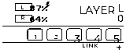
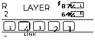
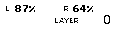
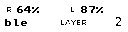

# ZMK LVGL XML Status Screens

[](https://github.com/MicheleYin/zmk-module-svg/actions/workflows/zmk-module.yml)

XML-authored status screens for Nice!View (160×68) and 128×32 SSD1306 OLEDs.
Firmware uses generated LVGL C; SVG and PNG are supported only as offline artwork
embedded during generation.

- XML authoring: [docs/widget-authoring-xml.md](docs/widget-authoring-xml.md)
- Paired preview gallery: [docs/ui/gallery](docs/ui/gallery/)
- Build and contributor notes: [AGENTS.md](AGENTS.md)
- Agent / contributor commands: [AGENTS.md](AGENTS.md)

WPM is not enabled by this module, but remains in the optional status packet if
another configuration enables it.

## Screen Gallery

The paired previews use LVGL's native XML renderer and side-specific screen sources.
Each row shows central and peripheral status values in the matching left/right layout.

| Configuration | Left half | Right half |
| --- | --- | --- |
| Nice!View (160×68) |  |  |
| OLED (128×32) |  |  |

Build the LVGL renderer and regenerate the gallery after changing screens, widgets,
or artwork:

```sh
emcmake cmake -S tools/lvgl_wasm -B build/lvgl_wasm
cmake --build build/lvgl_wasm
uv run --isolated --with-requirements tools/requirements.txt python tools/render_xml_gallery.py
```

## XML Tooling

Screen sources and reusable widgets live under `docs/ui/`. Use the same field catalog
for validation, previews, and firmware generation. Live preview watches screen XML,
nested widgets, and referenced artwork and refreshes when those files change.

```sh
uv run --isolated --with-requirements tools/requirements.txt python tools/nice_view_xml.py validate docs/ui/screens/nice-view-left.xml
uv run --isolated --with-requirements tools/requirements.txt python tools/nice_view_xml.py generate docs/ui/screens/nice-view-left.xml --output-dir src/generated_xml/nice_view_left
uv run --isolated --with-requirements tools/requirements.txt python tools/nice_view_xml.py preview docs/ui/screens/nice-view-left.xml --values tools/sample_status.central.json --role central --output /tmp/nice_view_left.png
uv run --isolated --with-requirements tools/requirements.txt python tools/nice_view_xml_live.py docs/ui/screens/nice-view-left.xml
uv run --isolated --with-requirements tools/requirements.txt python tools/nice_view_xml_live.py docs/ui/screens/nice-view-left.xml --right-screen docs/ui/screens/nice-view-right.xml
uv run --isolated --with-requirements tools/requirements.txt python tools/render_xml_gallery.py
uv run --isolated --with-requirements tools/requirements.txt python -m unittest test_nice_view_xml
```

| Screen | Generate `--output-dir` |
| --- | --- |
| `docs/ui/screens/nice-view-left.xml` | `src/generated_xml/nice_view_left` |
| `docs/ui/screens/nice-view-right.xml` | `src/generated_xml/nice_view_right` |
| `docs/ui/screens/oled-left.xml` | `src/generated_xml/oled_left` |
| `docs/ui/screens/oled-right.xml` | `src/generated_xml/oled_right` |

```conf
CONFIG_ZMK_SVG=y
CONFIG_ZMK_SVG_SCREEN=y
```

WPM remains available when `CONFIG_ZMK_WPM` is enabled.

### Different themes on each half

Each half is built as a separate firmware image, so it can use a different screen theme. To use the day screen on the left and night screen on the right, enable the XML screen in both images and select one theme per image:

```conf
# Both halves
CONFIG_ZMK_SVG=y
CONFIG_ZMK_SVG_SCREEN=y
CONFIG_NICE_VIEW_WIDGET_STATUS=n
```

```conf
# Left Nice!View uses the left XML screen
CONFIG_ZMK_SVG_THEME_LEFT=y
```

```conf
# Right Nice!View uses the right XML screen
CONFIG_ZMK_SVG_THEME_RIGHT=y
```

## Compatibility and setup

This module is currently supported with MicheleYin's ZMK fork on the `feature/nice-view` branch. It depends on that branch's split-BLE status synchronization and peripheral battery level/charge-state fetching, which let both Nice!View displays show central-owned status and the remote half's battery data. The module enables these fork-specific Kconfig features, so upstream ZMK or another revision is not a supported replacement.

Pin both ZMK and this module in your configuration's `config/west.yml`:

```yaml
manifest:
    projects:
        - name: zmk
            url: https://github.com/MicheleYin/zmk.git
            revision: feature/nice-view
            import: app/west.yml
        - name: zmk-module-svg
            url: https://github.com/MicheleYin/zmk-module-svg
            revision: feature/nice-view
```

Update the projects after changing the manifest:

```sh
west update
```

For a new West workspace, initialize it from your configuration repository, then update and export Zephyr:

```sh
west init -l config
west update
west zephyr-export
```

## Use the Module

Enable ZMK SVG in the configuration used by each display:

```conf
CONFIG_ZMK_SVG=y
```

For Nice!View shields only, also disable the built-in Nice!View status screen:

```conf
CONFIG_NICE_VIEW_WIDGET_STATUS=n
```

### Nice!View color polarity

Nice!View uses black for a set pixel and white for a clear pixel. ZMK SVG defaults to black artwork on a white background; leave `CONFIG_NICE_VIEW_WIDGET_INVERTED` unset for this usual appearance. You can reverse black and white by enabling the Nice!View option in each half's configuration:

```conf
CONFIG_NICE_VIEW_WIDGET_INVERTED=y
```

Inverted white-on-black LVGL text can appear thinner. If that is undesirable, leave the inversion option unset. If it must be enabled for another part of the display but ZMK SVG should stay black-on-white, set this module option in each half's configuration:

```conf
CONFIG_ZMK_SVG_WHITE_BACKGROUND=y
```

To highlight the right side in the split indicator, set this only in the right half's configuration:

```conf
CONFIG_ZMK_SVG_RIGHT_HALF=y
```

Keep `nice_view` in the shield list for Nice!View panels. For SSD1306 panels, enable `ZMK_DISPLAY` in the shield configuration. The module requires `ZMK_DISPLAY` and Settings; native layouts support 160 x 68 and 128 x 32. SVG headers are selected at build time from the chosen display's Devicetree dimensions, and a mismatched header stops the build. Split BLE status synchronization is selected automatically for split BLE builds.

The XML screen is selected by display dimensions and physical side: 160×68 uses the left/right Nice!View screen, while 128×32 uses the left/right OLED screen. Set `CONFIG_ZMK_SVG_RIGHT_HALF=y` on the physical right half. For Nice!View, `CONFIG_ZMK_SVG_THEME_LEFT=y` or `CONFIG_ZMK_SVG_THEME_RIGHT=y` can force a side layout. `CONFIG_ZMK_SVG_WHITE_BACKGROUND=y` keeps empty areas white even when legacy Nice!View widget inversion is enabled. See [LVGL XML authoring](docs/widget-authoring-xml.md) for the complete source-to-firmware workflow. Version-1 saved layout records fall back to the version-2 defaults.
