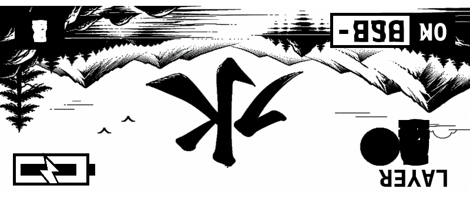

# ZMK SVG / LVGL XML

[](https://github.com/MicheleYin/zmk-module-svg/actions/workflows/zmk-module.yml)

Status screens for Nice!View (160×68) and 128×32 SSD1306 OLEDs. You can author
screens as **SVG** (Inkscape + `data-nvp-*`, default) or **LVGL component XML**
(`CONFIG_ZMK_SVG_LVGL_XML=y`) with optional offline SVG/PNG decoration. Both
paths generate LVGL bitmaps/bindings; the keyboard never parses SVG at runtime.

- SVG authoring: [docs/widget-authoring.md](docs/widget-authoring.md)
- XML authoring: [docs/widget-authoring-xml.md](docs/widget-authoring-xml.md)
- Pipeline comparison / gaps: [docs/xml-vs-svg.md](docs/xml-vs-svg.md)
- Agent / contributor commands: [AGENTS.md](AGENTS.md)

WPM is not enabled by this module, but remains in the optional status packet if
another configuration enables it.

## Screen preview

The five widget groups follow the SVG on the 160 x 68 pixel display: paired battery meters and a large layer tile at the top, profile buttons across the middle, then host and split status along the bottom. A lightning bolt inside a filled battery marks charging.

Both halves show this same screen and the same central/peripheral values. The preview uses the native 160 x 68 landscape proportions and current widget coordinates; glyph shapes and font rendering are approximations.

The split-link indicator shows connected or disconnected state on both halves. On the central it means at least one peripheral is connected; on a peripheral it means its link to the central is connected.


The pixel positions and widget bounds are listed in [the widget restyle proposal](docs/widget-restyle-proposal.md).

## LVGL XML tooling

Component XML under `docs/ui/` uses the same `tools/status_fields.json` catalog as SVG.
Validate / generate / live-preview, then enable `CONFIG_ZMK_SVG_LVGL_XML=y` in firmware.
Decorative art can be PNG or SVG files referenced with `<lv_image src="…">` (rasterized
offline into I1/I2). Details: [LVGL XML authoring](docs/widget-authoring-xml.md).

```sh
uv run --isolated --with-requirements tools/requirements.txt python tools/nice_view_xml.py validate docs/ui/screens/status_screen.xml
uv run --isolated --with-requirements tools/requirements.txt python tools/nice_view_xml.py generate docs/ui/screens/status_screen.xml --output-dir src/generated_xml/default
uv run --isolated --with-requirements tools/requirements.txt python tools/nice_view_xml.py preview docs/ui/screens/status_screen.xml --values tools/sample_status.central.json --role central --output /tmp/status_xml.png
uv run --isolated --with-requirements tools/requirements.txt python tools/nice_view_xml_live.py docs/ui/screens/status_screen.xml
uv run --isolated --with-requirements tools/requirements.txt python -m unittest test_nice_view_xml
```

| Screen | Generate `--output-dir` |
| --- | --- |
| `docs/ui/screens/status_screen.xml` | `src/generated_xml/default` |
| `docs/ui/screens/day.xml` | `src/generated_xml/day` |
| `docs/ui/screens/night.xml` | `src/generated_xml/night` |
| `docs/ui/screens/oled-128x32.xml` | `src/generated_xml/oled` |
| `docs/ui/screens/oled-128x32-mirror.xml` | `src/generated_xml/oled_mirror` |

```conf
CONFIG_ZMK_SVG=y
CONFIG_ZMK_SVG_SCREEN=y
CONFIG_ZMK_SVG_LVGL_XML=y
# OLED 128x32 AUTO: also CONFIG_ZMK_SVG_LVGL_XML_OLED=y
```

Live preview reuses the SVG live HTML UI (`/config`, `/render`). SVG tooling below remains
available when `CONFIG_ZMK_SVG_LVGL_XML` is disabled.

## SVG tooling

The validator, previewer, and bitmap-header generator use `uv` to provide Python dependencies in an isolated cached environment; Pillow is not installed into your selected Python. `rsvg-convert` must be available on `PATH` for rasterization.

```sh
uv run --isolated --with-requirements tools/requirements.txt python tools/nice_view_svg.py validate docs/nice-view-plus-preview.svg
uv run --isolated --with-requirements tools/requirements.txt python tools/nice_view_svg.py preview docs/nice-view-plus-preview.svg --values tools/sample_status.central.json --role central --output /tmp/nice_view_plus_central.png
uv run --isolated --with-requirements tools/requirements.txt python tools/nice_view_svg.py preview docs/nice-view-plus-preview.svg --values tools/sample_status.peripheral.json --role peripheral --output /tmp/nice_view_plus_peripheral.png
uv run --isolated --with-requirements tools/requirements.txt python tools/nice_view_svg.py generate docs/nice-view-plus-preview.svg --output /tmp/nice_view_plus_svg.h
uv run --isolated --with-requirements tools/requirements.txt python tools/nice_view_svg_live.py docs/screens/day.svg
uv run --isolated --with-requirements tools/requirements.txt python -m unittest test_nice_view_svg
```

The live preview opens a 1-bit monochrome raster at the source SVG's dimensions, using the same black/white threshold as firmware generation. Change any bound status field to simulate text, percentages, bars, rings, or conditional elements; switch between central and peripheral roles and choose legacy or white-background polarity. Use `--legacy-inverted` when firmware has `CONFIG_NICE_VIEW_WIDGET_INVERTED=y`. Stop the preview server with `Ctrl+C`.

WPM values are available when `CONFIG_ZMK_WPM` is enabled.

The static preview also supports `--invert` and `--rotate-180` for inspecting output polarity and artwork orientation. These affect preview images only, not firmware display orientation.

Dynamic elements use `data-nvp-bind`, `data-nvp-render`, and optional `data-nvp-role` SVG attributes. Their typed field definitions live in `tools/status_fields.json`; sample values for each half are in `tools/sample_status.*.json`. SVGs are limited to 22 dynamic bindings to keep the LVGL object budget bounded; firmware pool use still needs to be verified on device.

For the screen and widget authoring format, supported widget types, dynamic icon states, and new-screen workflow, see [Screen and Widget Authoring](docs/widget-authoring.md). A validated example is available at [widget-example.svg](docs/widget-example.svg).

The designs in [docs/examples](docs/examples/) and themes in [docs/screens](docs/screens/) can be validated, previewed, and generated as firmware theme headers using the commands in the authoring guide.

| Example | Preview | Highlights |
| --- | --- | --- |
| [activity.svg](docs/examples/activity.svg) |  | Paired battery progress rings with charging marks and compact status details. |
| [cards.svg](docs/examples/cards.svg) |  | Segmented battery, layer, and host cards above a BLE profile row. |
| [compact.svg](docs/examples/compact.svg) |  | Prominent battery meters and layer number with host and split status in the footer. |
| [day.svg](docs/screens/day.svg) |  | Daytime mountain theme with battery, layer, host, profile, and split status. |
| [infograph.svg](docs/examples/infograph.svg) |  | Circular battery complications with layer, host, and BLE profile status. |
| [night.svg](docs/screens/night.svg) |  | Nighttime mountain theme with battery, layer, host, profile, and split status. |
| [rounded.svg](docs/examples/rounded.svg) |  | Rounded battery panels, a pill-shaped layer display, and BLE profile selector. |
| [three-column.svg](docs/examples/three-column.svg) |  | Narrow battery, layer, and host columns with BLE profiles along the bottom. |
| [wpm.svg](docs/examples/wpm.svg) |  | Large WPM value in a clean monochrome panel. |
| [wpm-tile.svg](docs/examples/wpm-tile.svg) |  | High-contrast WPM tile with a compact pace label. |
| [watch.svg](docs/examples/watch.svg) |  | Watch-face layout with battery bars, a circular layer complication, and host status. |
| [shan.svg](docs/examples/shan.svg) |  | Mountain theme with battery, layer, host, profile, and split status. |
| [shui](docs/examples/shui.svg) |  | Water theme with battery, layer, host, profile, and split status. It is mirrored on purpose so that when paired with Shan it looks like a canvas|
| [rounded.svg](docs/examples/rounded.svg) |  | Rounded battery panels, a pill-shaped layer display, and BLE profile selector. |

### Different themes on each half

Each half is built as a separate firmware image, so it can use a different screen theme. To use the sun/day screen on the left and the moon/night screen on the right, enable SVG screens in both images and select one theme per image:

```conf
# Both halves
CONFIG_ZMK_SVG=y
CONFIG_ZMK_SVG_SCREEN=y
CONFIG_NICE_VIEW_WIDGET_STATUS=n
```

```conf
# Left half uses the sun/day artwork
CONFIG_ZMK_SVG_THEME_LEFT=y
```

```conf
# Right half uses the moon/night artwork
CONFIG_ZMK_SVG_THEME_RIGHT=y
```

## Compatibility and setup

This module is currently supported with MicheleYin's ZMK fork on the `feature/nice-view` branch. It depends on that branch's split-BLE status synchronization and peripheral battery level/charge-state fetching, which let both Nice!View displays show central-owned status and the remote half's battery data. The module enables these fork-specific Kconfig features, so upstream ZMK or another revision is not a supported replacement.

Pin both ZMK and this module in your configuration's `config/west.yml`:

```yaml
manifest:
    projects:
        - name: zmk
            url: https://github.com/MicheleYin/zmk.git
            revision: feature/nice-view
            import: app/west.yml
        - name: zmk-module-svg
            url: https://github.com/MicheleYin/zmk-module-svg
            revision: feature/nice-view
```

Update the projects after changing the manifest:

```sh
west update
```

For a new West workspace, initialize it from your configuration repository, then update and export Zephyr:

```sh
west init -l config
west update
west zephyr-export
```

## Use the module

Enable ZMK SVG in the configuration used by each display:

```conf
CONFIG_ZMK_SVG=y
```

For Nice!View shields only, also disable the built-in Nice!View status screen:

```conf
CONFIG_NICE_VIEW_WIDGET_STATUS=n
```

### Nice!View color polarity

Nice!View uses black for a set pixel and white for a clear pixel. ZMK SVG defaults to black artwork on a white background; leave `CONFIG_NICE_VIEW_WIDGET_INVERTED` unset for this usual appearance. You can reverse black and white by enabling the Nice!View option in each half's configuration:

```conf
CONFIG_NICE_VIEW_WIDGET_INVERTED=y
```

Inverted white-on-black LVGL text can appear thinner. If that is undesirable, leave the inversion option unset. If it must be enabled for another part of the display but ZMK SVG should stay black-on-white, set this module option in each half's configuration:

```conf
CONFIG_ZMK_SVG_WHITE_BACKGROUND=y
```

To highlight the right side in the split indicator, set this only in the right half's configuration:

```conf
CONFIG_ZMK_SVG_RIGHT_HALF=y
```

Keep `nice_view` in the shield list for Nice!View panels. For SSD1306 panels, enable `ZMK_DISPLAY` in the shield configuration. The module requires `ZMK_DISPLAY` and Settings; native layouts support 160 x 68 and 128 x 32. SVG headers are selected at build time from the chosen display's Devicetree dimensions, and a mismatched header stops the build. Split BLE status synchronization is selected automatically for split BLE builds.

The status screen supports generated SVG artwork with `CONFIG_ZMK_SVG_SCREEN=y`. The default `Automatic` theme selects the 160 x 68 Nice!View screen or 128 x 32 OLED screen from the board's display node. Set `CONFIG_ZMK_SVG_RIGHT_HALF=y` on the right OLED half to use its mirrored SVG. For custom 160 x 68 Nice!View artwork, opt into the `Left` or `Right` theme; for OLED, edit both 128 x 32 SVG variants and regenerate their headers. `CONFIG_ZMK_SVG_WHITE_BACKGROUND=y` keeps empty areas white even when legacy Nice!View widget inversion is enabled. See [Screen and Widget Authoring](docs/widget-authoring.md) for the complete source-to-firmware workflow. Version-1 saved layout records fall back to the version-2 defaults.
