# ZMK Nice!view Plus

[](https://github.com/MicheleYin/zmk-module-nice-view-svg/actions/workflows/zmk-module.yml)

Nice!view Plus is a ZMK module for a configurable status screen on Nice!view displays. Both halves show central and peripheral battery levels, the active layer, BLE profiles, host output, and split status in the same landscape layout. WPM is not enabled by this module, but remains in the optional status packet if another configuration enables it.

## Screen preview

The five widget groups follow the SVG on the 160 x 68 pixel display: paired battery meters and a large layer tile at the top, profile buttons across the middle, then host and split status along the bottom. A lightning bolt inside a filled battery marks charging.

Both halves show this same screen and the same central/peripheral values. The preview uses the native 160 x 68 landscape proportions and current widget coordinates; glyph shapes and font rendering are approximations.

The split-link indicator shows connected or disconnected state on both halves. On the central it means at least one peripheral is connected; on a peripheral it means its link to the central is connected.

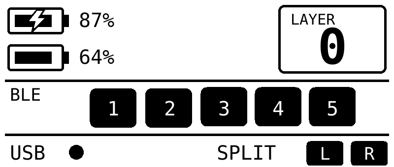

The pixel positions and widget bounds are listed in [the widget restyle proposal](docs/widget-restyle-proposal.md).

## SVG tooling

The validator, previewer, and bitmap-header generator use `uv` to provide Python dependencies in an isolated cached environment; Pillow is not installed into your selected Python. `rsvg-convert` must be available on `PATH` for rasterization.

```sh
uv run --isolated --with-requirements tools/requirements.txt python tools/nice_view_svg.py validate docs/nice-view-plus-preview.svg
uv run --isolated --with-requirements tools/requirements.txt python tools/nice_view_svg.py preview docs/nice-view-plus-preview.svg --values tools/sample_status.central.json --role central --output /tmp/nice_view_plus_central.png
uv run --isolated --with-requirements tools/requirements.txt python tools/nice_view_svg.py preview docs/nice-view-plus-preview.svg --values tools/sample_status.peripheral.json --role peripheral --output /tmp/nice_view_plus_peripheral.png
uv run --isolated --with-requirements tools/requirements.txt python tools/nice_view_svg.py generate docs/nice-view-plus-preview.svg --output /tmp/nice_view_plus_svg.h
uv run --isolated --with-requirements tools/requirements.txt python tools/nice_view_svg_live.py docs/screens/day.svg
uv run --isolated --with-requirements tools/requirements.txt python -m unittest test_nice_view_svg
```

The live preview opens a local browser view of the 160 x 68, 1-bit monochrome raster, using the same black/white threshold as firmware generation. Change any bound status field to simulate text, percentages, bars, rings, or conditional elements; switch between central and peripheral roles to inspect each display. Stop the preview server with `Ctrl+C`.

WPM values are available when `CONFIG_ZMK_WPM` is enabled.

The preview tool also supports `--rotate-180` for inspecting an artwork variant. This only rotates the generated preview image; it does not change firmware display orientation.

Dynamic elements use `data-nvp-bind`, `data-nvp-render`, and optional `data-nvp-role` SVG attributes. Their typed field definitions live in `tools/status_fields.json`; sample values for each half are in `tools/sample_status.*.json`. SVGs are limited to 22 dynamic bindings to keep the LVGL object budget bounded; firmware pool use still needs to be verified on device.

For the screen and widget authoring format, supported widget types, dynamic icon states, and new-screen workflow, see [Screen and Widget Authoring](docs/widget-authoring.md). A validated example is available at [widget-example.svg](docs/widget-example.svg).

The designs in [docs/examples](docs/examples/) and themes in [docs/screens](docs/screens/) can be validated, previewed, and generated as firmware theme headers using the commands in the authoring guide.

| Example | Preview | Highlights |
| --- | --- | --- |
| [activity.svg](docs/examples/activity.svg) | 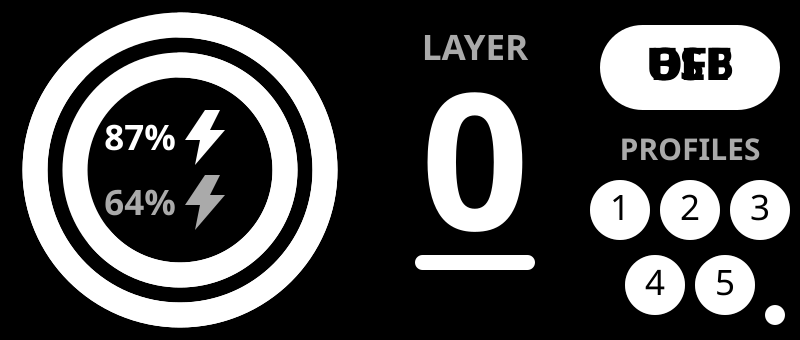 | Paired battery progress rings with charging marks and compact status details. |
| [cards.svg](docs/examples/cards.svg) | 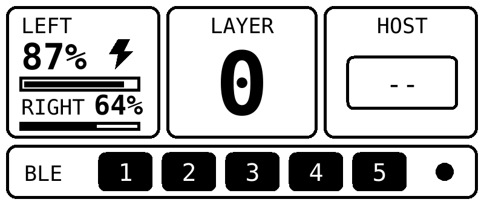 | Segmented battery, layer, and host cards above a BLE profile row. |
| [compact.svg](docs/examples/compact.svg) | 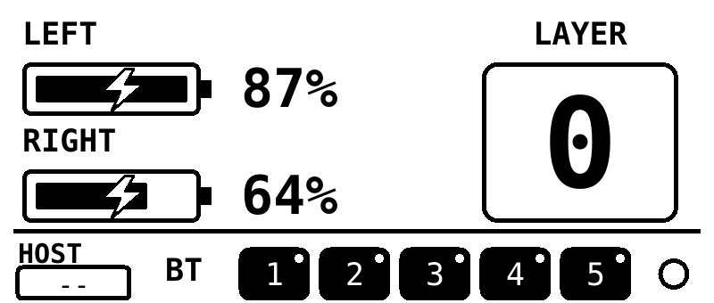 | Prominent battery meters and layer number with host and split status in the footer. |
| [day.svg](docs/screens/day.svg) | 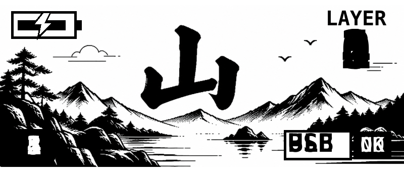 | Daytime mountain theme with battery, layer, host, profile, and split status. |
| [infograph.svg](docs/examples/infograph.svg) | 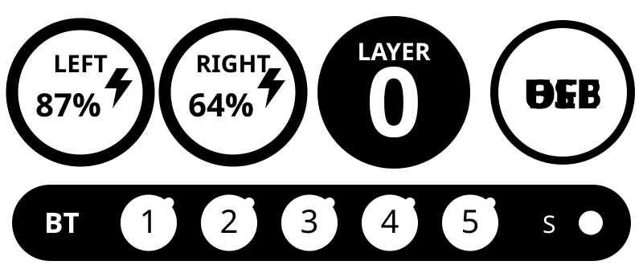 | Circular battery complications with layer, host, and BLE profile status. |
| [night.svg](docs/screens/night.svg) | 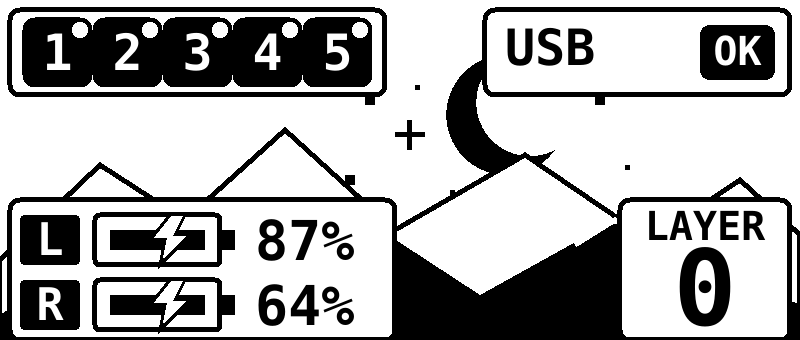 | Nighttime mountain theme with battery, layer, host, profile, and split status. |
| [rounded.svg](docs/examples/rounded.svg) | 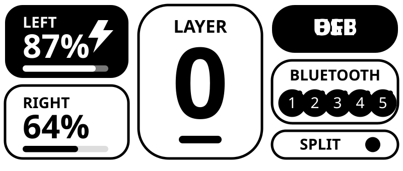 | Rounded battery panels, a pill-shaped layer display, and BLE profile selector. |
| [terminal.svg](docs/examples/terminal.svg) | 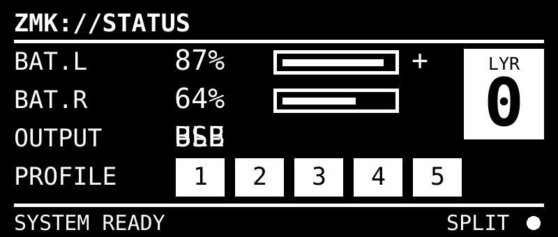 | Monospace status readout with battery bars, host output, and profile indicators. |
| [three-column.svg](docs/examples/three-column.svg) | 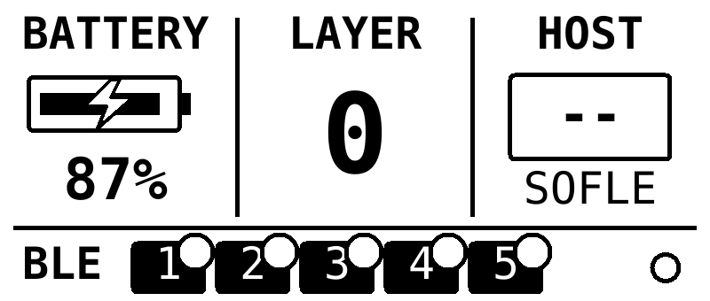 | Narrow battery, layer, and host columns with BLE profiles along the bottom. |
| [wpm.svg](docs/examples/wpm.svg) | 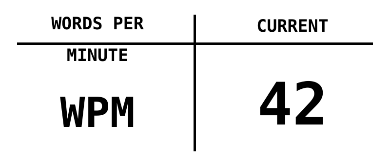 | Large WPM value in a clean monochrome panel. |
| [wpm-tile.svg](docs/examples/wpm-tile.svg) | 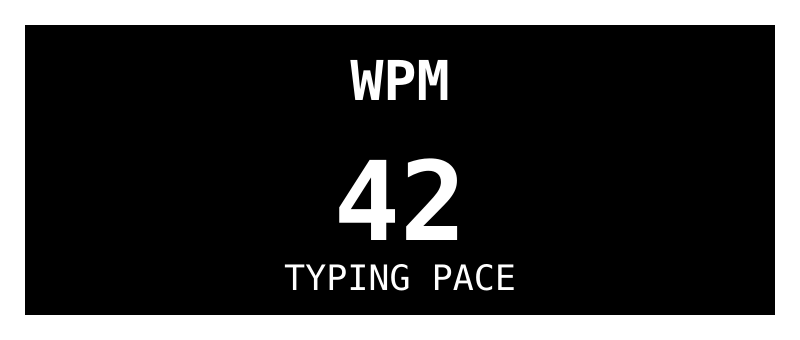 | High-contrast WPM tile with a compact pace label. |
| [watch.svg](docs/examples/watch.svg) | 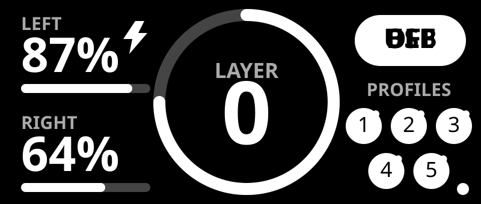 | Watch-face layout with battery bars, a circular layer complication, and host status. |

### Different themes on each half

Each half is built as a separate firmware image, so it can use a different screen theme. To use the sun/day screen on the left and the moon/night screen on the right, enable SVG screens in both images and select one theme per image:

```conf
# Both halves
CONFIG_ZMK_NICE_VIEW_PLUS=y
CONFIG_ZMK_NICE_VIEW_PLUS_SVG_SCREEN=y
CONFIG_NICE_VIEW_WIDGET_STATUS=n
```

```conf
# Left half uses the sun/day artwork
CONFIG_ZMK_NICE_VIEW_PLUS_SVG_THEME_LEFT=y
```

```conf
# Right half uses the moon/night artwork
CONFIG_ZMK_NICE_VIEW_PLUS_SVG_THEME_RIGHT=y
```

## Compatibility and setup

This module is currently supported with MicheleYin's ZMK fork on the `feature/nice-view` branch. It depends on that branch's split-BLE status synchronization and peripheral battery level/charge-state fetching, which let both Nice!view displays show central-owned status and the remote half's battery data. The module enables these fork-specific Kconfig features, so upstream ZMK or another revision is not a supported replacement.

Pin both ZMK and this module in your configuration's `config/west.yml`:

```yaml
manifest:
    projects:
        - name: zmk
            url: https://github.com/MicheleYin/zmk.git
            revision: feature/nice-view
            import: app/west.yml
        - name: zmk-module-nice-view-svg
            url: https://github.com/MicheleYin/zmk-module-nice-view-svg
            revision: feature/nice-view
```

Update the projects after changing the manifest:

```sh
west update
```

For a new West workspace, initialize it from your configuration repository, then update and export Zephyr:

```sh
west init -l config
west update
west zephyr-export
```

## Use the module

In the configuration file used by each half, disable Nice!view's built-in screen and enable Nice!view Plus:

```conf
CONFIG_NICE_VIEW_WIDGET_STATUS=n
CONFIG_ZMK_NICE_VIEW_PLUS=y
```

To highlight the right side in the split indicator, set this only in the right half's configuration:

```conf
CONFIG_ZMK_NICE_VIEW_PLUS_RIGHT_HALF=y
```

Keep `nice_view` in the shield list and ensure Settings/NVS is enabled for persistent layouts. The module requires `ZMK_DISPLAY` and Settings; split BLE status synchronization is selected automatically for split BLE builds.

The status screen supports generated SVG artwork with `CONFIG_ZMK_NICE_VIEW_PLUS_SVG_SCREEN=y`. The left and right selectors load `src/generated_day_screen.h` and `src/generated_night_screen.h`; their editable SVG sources are `docs/screens/day.svg` and `docs/screens/night.svg`. The default theme matches `docs/screens/default.svg`. Edit a source and regenerate its checked-in header as described in [Screen and Widget Authoring](docs/widget-authoring.md). Version-1 saved layout records fall back to the version-2 defaults.
