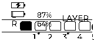

# ZMK XML Widget Restyle Proposal

## Scope

Use the 160 x 68 landscape canvas to match the supplied SVG: paired battery meters and a large layer tile at the top, BLE profile buttons across the center, and output/split status along the bottom. Both halves show central and peripheral battery state, host output, BLE profiles, active layer, and the split arrangement in the same layout. WPM is not enabled by this module and has no screen row. The status packet retains its WPM field and sends WPM updates when another configuration enables `CONFIG_ZMK_WPM`.

## Current Widgets

| Widget | Current display | Current source and behavior |
| --- | --- | --- |
| Battery | Paired outlined meters, `C`/`P` percentages, fill bars, and an in-meter charging bolt | Both charge states are mirrored to both displays. |
| Layer | Large numbered tile with a small `LAYER` heading | The active index is included in the BLE status snapshot. |
| BLE profiles | `BLE` label and numbered rectangular buttons | Selected profile is filled; all other profiles are outlined. State is mirrored from the central. |
| Host/output | `USB`, `BLE`, or `--` with a connection dot | Computed by the central and included in the BLE status snapshot. |
| Split | `SPLIT` label and left/right half markers | Static split graphic; the same marker is shown on both displays. |

The previous implementation used six text labels in a two-column arrangement. The new layout has five groups, with the battery group containing two rows. Saved layout records use layout version 2; a version-1 saved layout is ignored and the version-2 defaults are used. The split status packet is version 2 to include central battery state.

## Theme-Matched Landscape Layout

### Pixel Layout

The Nice!view canvas is 160 x 68 pixels: `x=0..159`, `y=0..67`. Group origins and child positions below are absolute display coordinates. Text uses `lv_font_unscii_8` for battery/profile labels and Montserrat 8/12/20 for charge, headings, and the layer tile. Glyph ink is character-dependent, so text bounds describe character cells rather than solid pixel rectangles.

| Widget group | Origin and size | Drawn details |
| --- | --- | --- |
| Battery | `(0, 0)`, `88 x 30` | Shells `(3, 3)` and `(3, 18)`, each `22 x 10`; caps at x=26; fill bars at x=6, up to `18 x 5`; labels at x=32; charging bolt overlays the filled central meter. |
| Layer | `(113, 2)`, `45 x 28` | Rounded `43 x 27` border; `LAYER` heading at `(117, 3)`; centered layer number uses 20-pixel Montserrat. |
| BLE profiles | `(0, 35)`, `160 x 18` | `BLE` at `(4, 37)`; up to eight rectangular buttons begin at x=37, y=36. Five-profile buttons are `18 x 15` with 22-pixel pitch; larger profile counts use narrower buttons. |
| Host/output | `(0, 56)`, `80 x 12` | Text at `(4, 57)`; 6-pixel status dot at `(28, 59)`. |
| Split | `(88, 56)`, `72 x 12` | `SPLIT` label at `(88, 57)`; filled L marker at `(125, 58)` and outlined R marker at `(143, 58)`, both `14 x 9`. |

Dividers span `(2, 33)` to `(158, 33)` and `(2, 55)` to `(158, 55)`. Battery fills scale to `floor(18 * percentage / 100)` pixels. A white charging-bolt symbol overlays the fill while charging; unknown levels show `--`. Profile selection uses a filled button, while every non-selected profile is outlined. The inversion setting swaps foreground/background colors.

The generated preview uses the native LVGL renderer at 160 x 68. It shows USB, profile 1 selected, central battery charging at 87%, peripheral battery at 64%, and layer 0.

The screen has no WPM row. The display output remains in its native 160 x 68 orientation; arrange the artwork and widgets in XML for the desired reading direction.

## Mirroring Rules

- Use the same widget order and visual treatment on both halves.
- Mirror central and peripheral battery state, host/output, BLE profile state, and active layer to both displays.
- Retain WPM in the status packet and send its updates only when `CONFIG_ZMK_WPM` is enabled; this module does not enable or render WPM itself.
- Show the same static split arrangement icon on both displays without role-specific text.
- Display the same layer index on both halves. The split status packet is version 2 and includes central battery state.

## Acceptance Criteria

- All five widget groups fit on the 160 x 68 display without overlap or clipping.
- Both halves render the same order, spacing, typography, and status labels.
- Central-owned values match on both displays after status updates.
- Both battery rows show the same central/peripheral values and charging state on both displays.
- The same active layer index appears on both halves.
- Version-2 layout defaults and saved layouts remain valid; version-1 saved layouts fall back to defaults.
